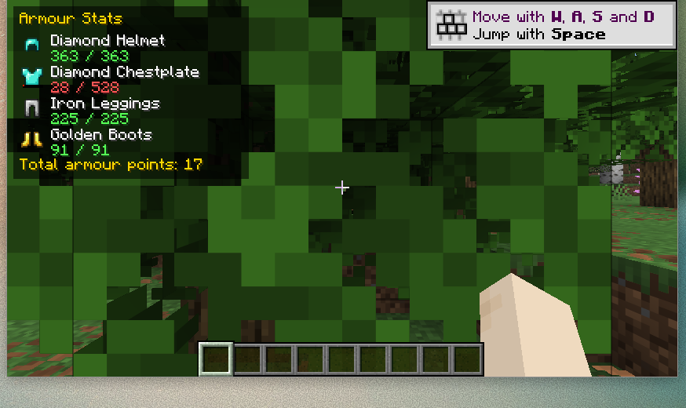

# mc-mod-armour-stats

A Minecraft mod to show the status of your equipped armour on the HUD.

The mod draws a compact panel in the top-left of the screen listing each
equipped armour piece (head, chest, legs, feet), its remaining durability
(colour-coded) and your total armour points.

## Screenshot



The durability of each piece is colour-coded — green when healthy, yellow when
worn and red when nearly broken (e.g. the damaged Diamond Chestplate above).

## Demo

A short screen recording of the HUD updating live as armour is equipped is
available at [`docs/armour-stats-hud-demo.mp4`](docs/armour-stats-hud-demo.mp4).

## Requirements

- Minecraft **26.2** (Fabric)
- [Fabric Loader](https://fabricmc.net/) `>= 0.19.0`
- [Fabric API](https://modrinth.com/mod/fabric-api) `0.156.0+26.2`
- **Java 25** (required by Minecraft 26.2)

## Development

This is a [Fabric](https://fabricmc.net/) mod built with Gradle + Fabric Loom.

```bash
# Build the mod jar (output in build/libs/)
./gradlew build

# Launch a development Minecraft client with the mod loaded
./gradlew runClient
```

Gradle must run on a Java 25 JDK. If your default `java` is older, point
`JAVA_HOME` at a Java 25 installation, e.g.:

```bash
export JAVA_HOME=/path/to/jdk-25
./gradlew build
```

The built mod jar is written to `build/libs/armourstats-<version>.jar`.

## Project layout

| Path | Purpose |
| --- | --- |
| `src/main/java` | Common entrypoint (`ArmourStatsMod`) |
| `src/client/java` | Client entrypoint + HUD rendering (`ArmourStatsClient`, `ArmourStatsHud`) |
| `src/main/resources/fabric.mod.json` | Fabric mod metadata |

## License

[MIT](LICENSE)
