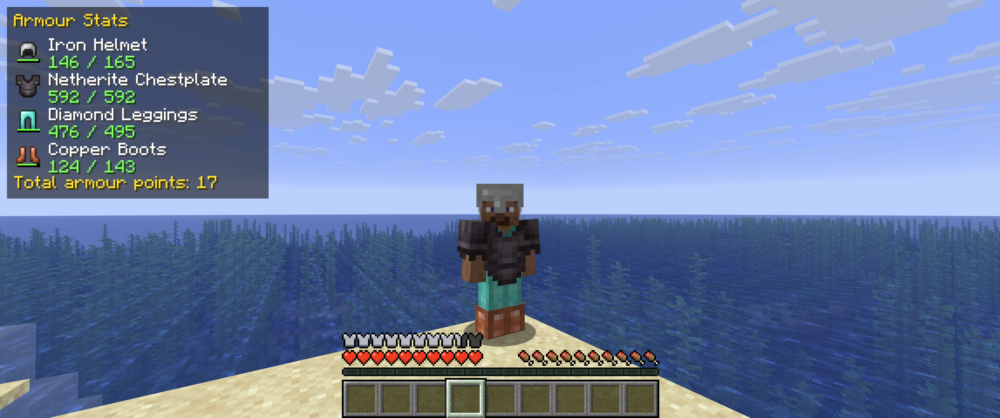

# Armour Stats HUD

A Minecraft mod to show the status of your equipped armour on the HUD.

Two display modes are available (toggle with `/armourstats`):

- **panel** - a compact panel in the top-left listing each equipped
  armour piece (head, chest, legs, feet), its remaining durability
  (colour-coded) and your total armour points.
- **hotbar** (default) - a row of hotbar-sized slots to the left of the hotbar showing
  just the armour icons and their durability bars.

## Screenshot



The durability of each piece is colour-coded — green when healthy, yellow when worn and red when nearly broken.

## Requirements

- Minecraft **26.2** (Fabric)
- [Fabric Loader](https://fabricmc.net/) `>= 0.19.0`
- [Fabric API](https://modrinth.com/mod/fabric-api) `0.156.0+26.2`
- **Java 25** (required by Minecraft 26.2)

## Commands

Client-side commands (work in singleplayer and on multiplayer):

| Command | Effect |
| --- | --- |
| `/armourstats` | Show the current display mode |
| `/armourstats toggle` | Cycle between `panel` and `hotbar` |
| `/armourstats mode` | Same as `toggle` |
| `/armourstats mode panel` | Use the detailed top-left panel |
| `/armourstats mode hotbar` | Use the hotbar icon row |

The chosen mode is saved to `config/armourstats.properties`.

## Development

This is a [Fabric](https://fabricmc.net/) mod built with Gradle + Fabric Loom.

```bash
# Build the mod jar (output in build/libs/)
./gradlew build

# Launch a development Minecraft client with the mod loaded
./gradlew runClient
```

The built mod jar is written to `build/libs/armourstats-<version>.jar`.

## Releasing

Releases are created by pushing a version tag. CI builds the mod and attaches
the jar to a GitHub Release.

1. Bump `mod_version` in [`gradle.properties`](gradle.properties) (e.g. `1.0.0`).
2. Commit the version bump on `master`.
3. Tag and push (keep the tag in sync with `mod_version`):

```bash
git tag v1.0.0
git push origin v1.0.0
```

The [Release](.github/workflows/release.yml) workflow runs on tags matching
`v*`, builds with `./gradlew build`, and publishes
`build/libs/armourstats-<version>.jar` to a new GitHub Release (with generated
release notes).

## License

[MIT](LICENSE)

---

Built with ❤️ for mstrspence ⛏️💎⛏️
